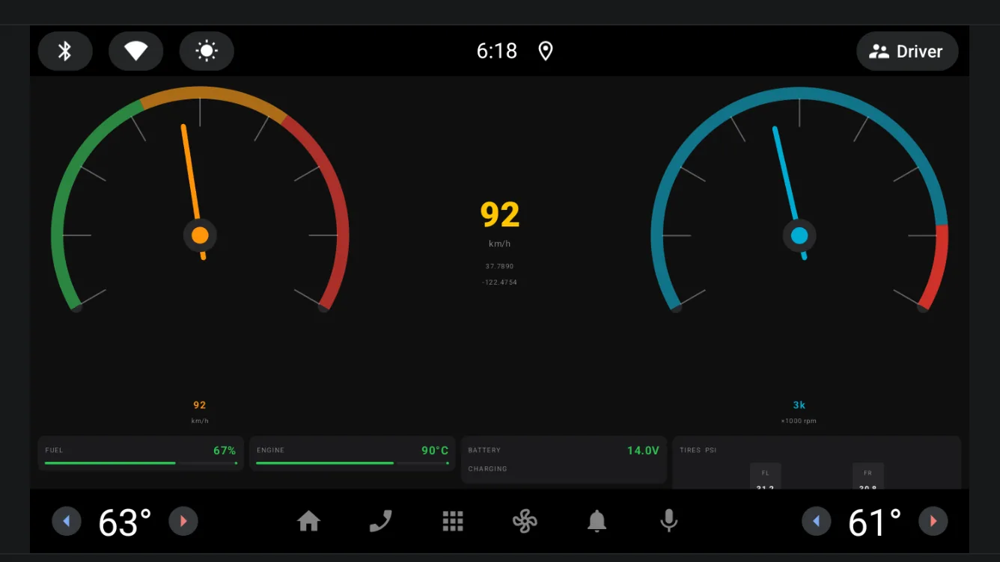
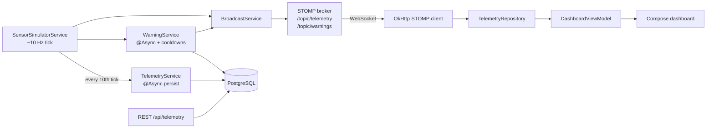
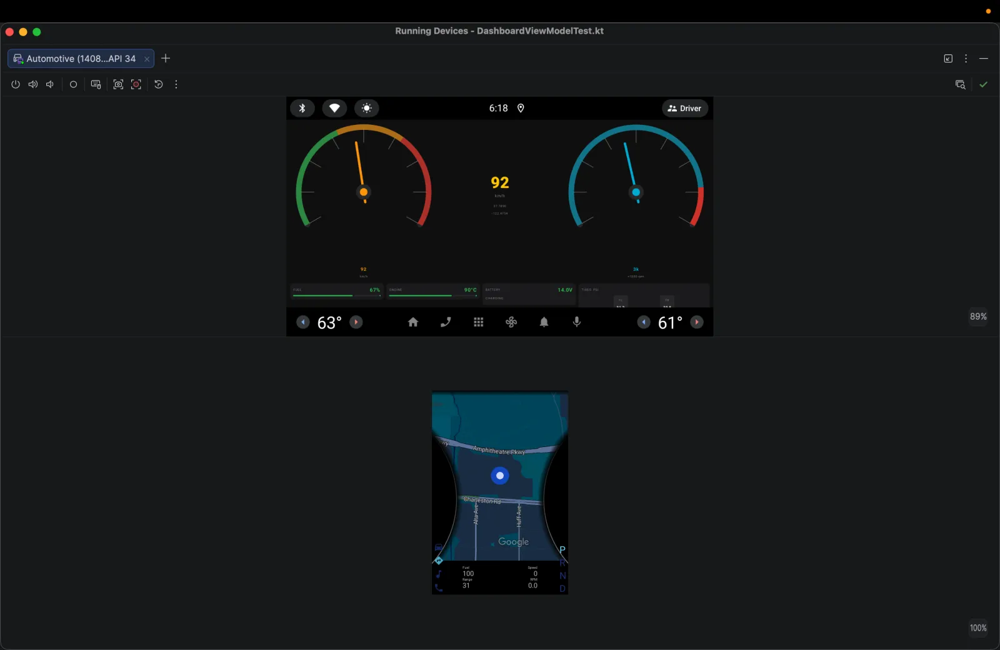

# Vehicle Telemetry

A real-time vehicle monitoring demo: a Spring Boot backend simulates in-car sensor data and streams it over STOMP/WebSocket to a Jetpack Compose dashboard built for Android Automotive OS (AAOS). Threshold warnings are evaluated on the server and pushed to the head unit as they happen.




## Overview

Instrument-cluster style apps need a steady, low-latency stream of vehicle data and must survive dropped connections. This project models that loop end to end:

- The **backend** runs a stateful sensor simulator at roughly 10 Hz, broadcasts each snapshot to WebSocket subscribers, checks it against configurable thresholds, and persists a throttled subset (about 1 Hz) to PostgreSQL.
- The **Android app** connects with a small hand-written STOMP client on top of OkHttp, reconnects with exponential backoff, and renders the data as animated gauges and status cards on a landscape AAOS display.

The sensor source is simulated. There is no real CAN bus or OBD-II integration.

## Key features

**Backend (`backend/`)**

- **Sensor simulator** – `SensorSimulatorService` ticks every 100 ms (`fixedDelay`) and models speed (mean-reverting random walk), RPM (gear-based curve), engine warm-up, fuel burn, battery voltage, GPS drift and four tire pressures.
- **STOMP over WebSocket** – `WebSocketConfig` exposes `/ws` (SockJS, with the raw WebSocket transport at `/ws/websocket`) and an in-memory broker for `/topic/telemetry` and `/topic/warnings`.
- **Stateful warning engine** – `WarningService` checks overspeed, high RPM, low fuel (CRITICAL below 5%), engine overheat, low battery and low/high pressure per tire. Each warning type has a 100-tick cooldown (about 10 s) so the client is not flooded. Warnings are broadcast and stored in `warning_logs`.
- **Throttled async persistence** – every 10th tick (about 1 Hz) a snapshot is saved by `TelemetryService.persistAsync` on a dedicated `ThreadPoolTaskExecutor` (4–8 threads, queue of 500), so database writes never block the simulator thread. Each snapshot is a single insert; writes are not batched.
- **Indexed history** – both tables have a composite index on `(vehicle_id, <timestamp> DESC)`, declared in the JPA entities and in `docker/postgres/init.sql`.
- **REST API** – paginated history (page size capped at 200), latest snapshot and 24-hour statistics.
- **Data retention** – a daily job at 02:00 deletes telemetry older than 30 days.
- **Ops basics** – Actuator `health`, `info` and `metrics`; JSON error responses from a global exception handler; multi-stage Dockerfile running as a non-root user.

**Android app (`android/`)**

- **Jetpack Compose dashboard** – Canvas-drawn speed and RPM gauges with spring animation, a central speed readout with GPS coordinates, and cards for fuel, engine temperature, battery and tire pressure.
- **Connection-aware UI** – a status bar (LIVE / CONNECTING / RECONNECTING / ERROR), full-screen connecting and error states, and a manual reconnect button.
- **Live warning banner** – slides in for each warning, pulses for CRITICAL severity and auto-dismisses after 6 seconds.
- **Minimal STOMP client** – `TelemetryWebSocketClient` sends CONNECT/SUBSCRIBE frames, parses MESSAGE frames into Kotlin `Flow`s, and reconnects with exponential backoff plus 20% jitter (2 s base, 60 s cap, 10 attempts).
- **Foreground service** – `TelemetryForegroundService` (`foregroundServiceType="dataSync"`) keeps the stream alive while another app is in front, with a Stop action in the notification.
- **Layered architecture** – Hilt DI, MVVM with `StateFlow`, use cases and a repository interface between the WebSocket client and the UI.

## Tech stack

| Layer | Technology |
| --- | --- |
| Backend | Java 21, Spring Boot 3.3.5 (Web, WebSocket/STOMP, Data JPA, Validation, Security, Actuator), Lombok |
| Database | PostgreSQL 15 (Docker image `postgres:15-alpine`) |
| Android | Kotlin 2.1.21, Jetpack Compose (BOM 2025.05.01, Material 3), Navigation Compose, Hilt 2.56.2, Coroutines/Flow |
| Networking (app) | OkHttp 4.12 WebSocket, Gson |
| Android SDK | minSdk 29, compile/target SDK 35, landscape, `android.hardware.type.automotive` (not required) |
| Build | Gradle 9.0 wrappers (backend and app), AGP 8.7.3, KSP |
| Testing | JUnit 5 + Mockito (backend), JUnit 4 + MockK + Turbine + coroutines-test (app) |
| Infra | Docker multi-stage build, Docker Compose |

## Architecture



**Data model**

| Table | Purpose | Index |
| --- | --- | --- |
| `telemetry_records` | One row per persisted snapshot (speed, RPM, fuel, engine temperature, battery, GPS, tire pressures) | `idx_vt_time (vehicle_id, recorded_at DESC)` |
| `warning_logs` | Every warning that passed its cooldown (type, severity, message, trigger and threshold values) | `idx_warn_time (vehicle_id, occurred_at DESC)` |

Thresholds live in `backend/src/main/resources/application.yml` under `telemetry.thresholds` and are injected with `@Value`.

The second screenshot shows the app in the Android Studio emulator (AAOS, API 34 system image), with the emulator's instrument-cluster display underneath:



## Project structure

```text
vehicle-telemetry/
├── backend/                     # Spring Boot service (Gradle)
│   ├── Dockerfile
│   └── src/main/java/com/vehicletelemetry/
│       ├── config/              # WebSocket, Security/CORS, async executor + retention job
│       ├── controller/          # REST endpoints
│       ├── service/             # simulator, broadcast, warnings, persistence
│       ├── model/entity/        # JPA entities
│       ├── repository/          # Spring Data repositories
│       └── dto/, exception/
├── android/                     # Android Automotive app (Gradle Kotlin DSL)
│   └── app/src/main/kotlin/com/vehicletelemetry/
│       ├── data/remote/         # STOMP/WebSocket client and DTOs
│       ├── data/repository/     # DTO -> domain mapping
│       ├── domain/              # models and use cases
│       ├── presentation/        # Compose screens, gauges, ViewModels, theme
│       ├── service/             # foreground service
│       └── core/                # DI modules, constants, utilities
├── docker/
│   ├── docker-compose.yml       # PostgreSQL + backend
│   └── postgres/init.sql        # schema and indexes
└── HOW_TO_BUILD.md              # build-order notes and design reasoning (Vietnamese)
```

## Getting started

### Prerequisites

- Docker with Docker Compose
- JDK 21 (only needed to run the backend outside Docker)
- Android Studio with Android SDK 35 and an **Automotive** system image (the screenshots use API 34)

### 1. Start PostgreSQL and the backend

```bash
cd docker
docker compose up --build
```

This starts `postgres:15-alpine` (database `vehicle_telemetry`, schema from `init.sql`) and builds and runs the backend on port 8080.

```bash
curl http://localhost:8080/actuator/health
```

To run the backend from your IDE or the command line instead, start only the database and use the Gradle wrapper:

```bash
cd docker && docker compose up postgres -d
cd ../backend && ./gradlew bootRun
```

### 2. Run the Android app

1. In Android Studio, open the `android/` folder and let Gradle sync.
2. Create an emulator: **Device Manager → Create Virtual Device → Automotive → Automotive (1024p landscape)** with an Automotive system image.
3. Run the `app` configuration on that emulator.

Debug builds connect to `ws://10.0.2.2:8080/ws/websocket` (`10.0.2.2` is the host machine as seen from the emulator). Cleartext traffic is allowed only for `10.0.2.2` and `localhost` in `res/xml/network_security_config.xml`. The URL is a `buildConfigField` in `android/app/build.gradle.kts`.

### 3. Run the tests

```bash
cd backend && ./gradlew test     # WarningServiceTest
cd android && ./gradlew test     # DashboardViewModelTest
```

## Environment variables

Backend values are read in `application.yml`. The defaults match the Docker Compose setup and are for local development only.

| Name | Required | Description |
| --- | --- | --- |
| `DB_URL` | No | JDBC URL. Default `jdbc:postgresql://localhost:5432/vehicle_telemetry` |
| `DB_USER` | No | Database user. Default matches `docker/docker-compose.yml` |
| `DB_PASS` | No | Database password. Default matches `docker/docker-compose.yml`; override it outside local development |
| `SERVER_PORT` | No | HTTP port. Default `8080` |

Simulator rate, vehicle ID, topic names and warning thresholds are plain configuration under the `telemetry.*` keys in the same file.

## API reference

### REST

All endpoints accept an optional `vehicleId` query parameter (default `VH-DEMO-001`). There is no authentication.

| Method | Path | Auth | Description |
| --- | --- | --- | --- |
| GET | `/api/telemetry/history?page=0&size=50` | None | Persisted snapshots, newest first. `size` is capped at 200 |
| GET | `/api/telemetry/latest` | None | Most recent persisted snapshot, or `404` if there is none |
| GET | `/api/telemetry/stats` | None | Last 24 hours: average speed, max speed, warning count |
| GET | `/actuator/health` | None | Health check (`info` and `metrics` are also exposed) |

### WebSocket (STOMP)

| Item | Value |
| --- | --- |
| SockJS endpoint | `/ws` |
| Raw WebSocket URL | `ws://localhost:8080/ws/websocket` |
| Telemetry topic | `/topic/telemetry` (one message per simulator tick) |
| Warning topic | `/topic/warnings` |

To watch the stream with any raw WebSocket client, connect to `ws://localhost:8080/ws/websocket` and send these frames (`^@` is the NUL byte that ends a STOMP frame):

```text
CONNECT
accept-version:1.2
heart-beat:0,0

^@
```

```text
SUBSCRIBE
id:sub-0
destination:/topic/telemetry

^@
```

### Useful ADB commands

```bash
adb logcat -s VT_WebSocket VT_FgService      # connection and service logs
adb shell pm clear com.vehicletelemetry      # reset app data
```

To try the reconnect logic, stop the backend (`docker compose stop backend`) while the app is running and watch `VT_WebSocket` log the backoff delays, then start it again.

## Deployment

The repository has a production-style Dockerfile and a Compose file for local use. There is no hosted deployment. The release build type in `android/app/build.gradle.kts` still points at a placeholder host (`your-backend.com`).

## Known limitations

- **Single simulated vehicle**: no real vehicle bus or OBD-II input.
- **No authentication**: all routes are `permitAll`, and CORS and the WebSocket endpoint accept any origin.
- **History and Settings screens can't be opened yet**: both are built and registered in `AppNavigation`, but the dashboard has no button that navigates to them. Settings toggles are kept in memory only and are not applied elsewhere.
- **Unused app dependencies**: the Room cache (entity, DAO, Hilt module), Retrofit and DataStore are declared but not used yet. The app does not cache data offline or call the REST API.
- **Constant door and seatbelt values**: the simulator never changes them, so those indicators do not trigger.
- **`/stats` warning count is always 0**: persisted snapshots always have `hasWarning = false`. Warnings themselves are stored in `warning_logs`.

## Author

**Lê Văn Trung Tính** — Software Engineer | AI Product Builder

- Website: [trungtinh.site](https://trungtinh.site)
- GitHub: [@tinhne](https://github.com/tinhne)
